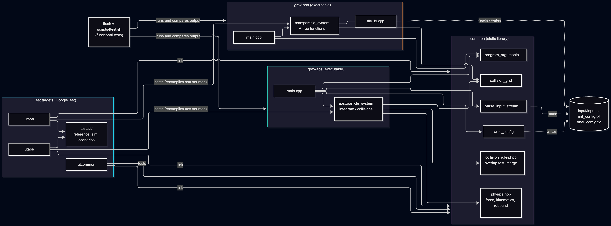
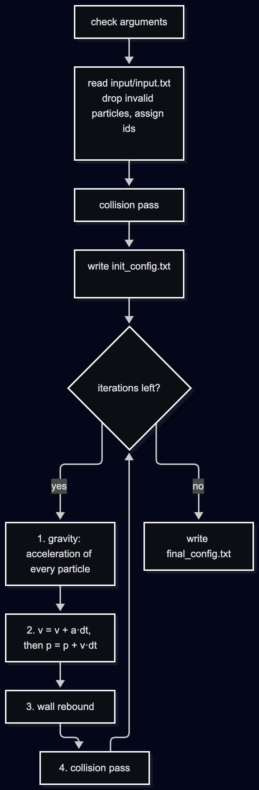
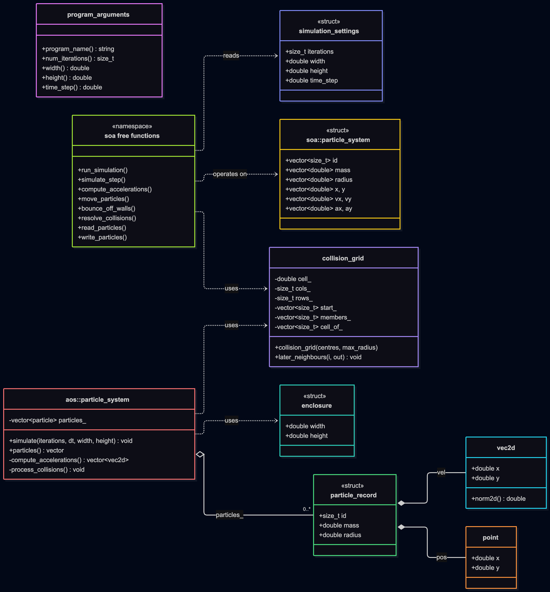
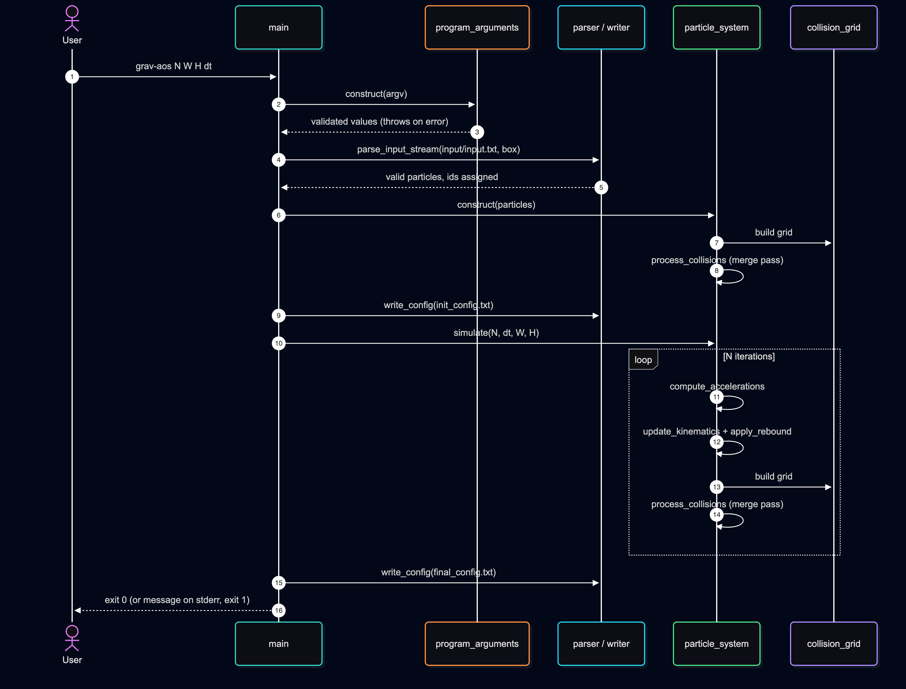
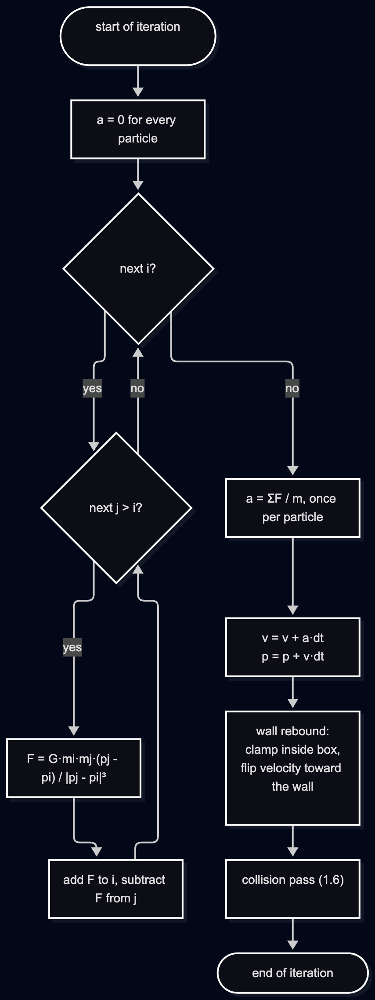
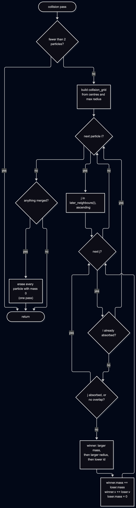
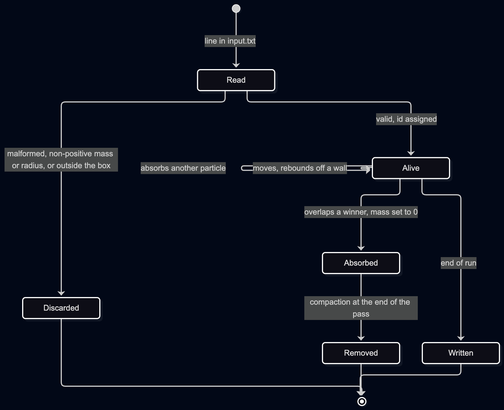

# 2D Gravity Simulator

Sequential C++23 simulation of gravitationally interacting objects in a closed
2D enclosure, for the Computer Architecture course at UC3M. There are two
implementations of the same simulation, built from the same repository:

| Executable | Particle storage |
|---|---|
| `grav-aos` | array of structures (one `particle` struct per object) |
| `grav-soa` | structure of arrays (one vector per attribute) |

The program is sequential. No threads or parallelism are used.

## Quick start

```bash
CXX=g++-15 cmake --preset default      # configure (downloads GSL and GoogleTest)
cmake --build --preset release         # builds grav-aos and grav-soa

mkdir -p run/input && cp input/input1K.txt run/input/input.txt
cd run
../out/build/default/aos/Release/grav-aos 500 1000 1000 0.25
../out/build/default/soa/Release/grav-soa 500 1000 1000 0.25
```

Run the programs from a directory that contains `input/input.txt`. They write
`init_config.txt` and `final_config.txt` into that same directory.

## Requirements

- g++-15 (set `CXX=g++-15` if it is not your default compiler)
- CMake 4.0 or newer
- Ninja (the presets use the Ninja Multi-Config generator)
- clang-tidy (optional, for static analysis)

GSL (v5.0.0) and GoogleTest (v1.18.0) are downloaded automatically at configure time.
Python 3 is needed for `tools/compare.py` (used by the functional tests); matplotlib
is needed only for `tools/plot.py`.

## Build

```bash
cmake --preset default
cmake --build --preset release          # or: debug
```

| Preset | Kind | What it does |
|---|---|---|
| `default` | configure | Ninja Multi-Config, Release and Debug configurations, build tree in `out/build/default/` |
| `clang-tidy` | configure | same as `default` with clang-tidy enabled |
| `release`, `debug` | build and test | build (or test) the Release / Debug configuration of `default` |
| `clang-tidy-release`, `clang-tidy-debug` | build | build with clang-tidy (run `cmake --preset clang-tidy` first) |

Release flags: `-O3 -DNDEBUG -fno-math-errno -fassociative-math -fno-signed-zeros
-fno-trapping-math` (set in `CMakePresets.json`). All builds use `-Wall -Wextra
-Wpedantic -Wconversion -Wsign-conversion` with warnings treated as errors.

Without presets, the equivalent manual commands are:

```bash
cmake -S . -B out/build/default -G "Ninja Multi-Config" \
  -DCMAKE_CXX_COMPILER=g++-15 \
  -DCMAKE_CXX_FLAGS_RELEASE="-O3 -DNDEBUG -fno-math-errno -fassociative-math -fno-signed-zeros -fno-trapping-math"
cmake --build out/build/default --config Release
ctest --test-dir out/build/default -C Release --output-on-failure
```

### Where the binaries end up

Build tree: `out/build/default/<folder>/<Configuration>/<target>`

| Target | Kind | Source folder | Release binary |
|---|---|---|---|
| `grav-aos` | executable | `aos/` | `out/build/default/aos/Release/grav-aos` |
| `grav-soa` | executable | `soa/` | `out/build/default/soa/Release/grav-soa` |
| `common` | static library | `common/` | linked into both executables |
| `utcommon` | unit tests | `utcommon/` | `out/build/default/utcommon/Release/utcommon` |
| `utaos` | unit tests | `utaos/` | `out/build/default/utaos/Release/utaos` |
| `utsoa` | unit tests | `utsoa/` | `out/build/default/utsoa/Release/utsoa` |

Naming: `grav-<layout>` for the simulators and `ut<folder>` for the unit-test
executables (`ut` + `common`, `aos` or `soa`). Replace `Release` with `Debug` for the debug build.

## Run

```
grav-aos <num_iterations> <width> <height> <time_step>
grav-soa <num_iterations> <width> <height> <time_step>
```

| Argument | Meaning |
|---|---|
| `num_iterations` | number of time steps to simulate |
| `width`, `height` | size of the enclosure |
| `time_step` | duration of one step |

Example: `grav-aos 100 1000 1000 0.25`

**Input:** `input/input.txt` in the current directory. One object per line, six
values: mass, radius, x, y, vx, vy. Invalid objects are dropped.
**Output**, written to the current directory:

| File | Contents |
|---|---|
| `init_config.txt` | state after the initial collision pass, before the first iteration |
| `final_config.txt` | state after the last iteration |

Both start with a header line `width height time_step count`, followed by one line
per object: `id: m r x y vx vy`. Both executables produce the same results.
On wrong arguments or missing input they exit with a non-zero code and print a
message prefixed `grav-aos:` / `grav-soa:` on stderr.

Example inputs in the repository's `input/` folder: `input1.txt`, `input1K.txt`
(1,000 objects) and `input10K.txt` (10,000 objects). Copy one to `input/input.txt`
in your run directory.

## Test

```bash
ctest --preset release --output-on-failure      # all unit tests (or: --preset debug)
```

To run one test executable directly, for example
`out/build/default/utaos/Release/utaos` (also accepts `--gtest_filter=...`).

| Test | Where | Notes |
|---|---|---|
| Unit tests (GoogleTest) | `utcommon/`, `utaos/`, `utsoa/`, helpers in `testutil/` | one executable per folder, registered with ctest |
| Functional tests | `ftest/cases/<name>/` | small hand-made cases; each has `args`, `input.txt`, `expected/{init,final}_config.txt` |
| Reference cases | `ftest/reference/{1k,10k}/` | the instructor's inputs and outputs |

To check a functional case by hand, run an executable with the case's `args` in a
directory whose `input/input.txt` is the case's `input.txt`, then compare the outputs with
`expected/` (`python3 tools/compare.py <ours> <expected>` accepts values within 0.001).

The helper scripts are in `scripts/` and are not needed to build or run:
`utest.sh`, `ftest.sh` (all functional cases plus error cases), `check_coverage.sh`
(coverage), and `build.sh`, `run_perf.sh`, `run_build_perf.sh` (slurm jobs for the avignon
cluster; measurements are in `perf/results/`, plots made with `tools/plot.py`).
CI (`.github/workflows/`) builds Debug and Release with g++-15 and runs the tests and
clang-tidy on pull requests.

## Design

Component diagram:



Main loop:



Class diagram:



Sequence diagram, one run:



Sequence diagram, one iteration:



Collision pass:



Life of a particle:



## Project layout

```
.
├── CMakeLists.txt, CMakePresets.json, cmake/   build configuration (presets, test helper)
├── common/        static library shared by both versions
│   ├── include/   progargs, input_parser, config_writer, physics, collision_rules,
│   │              collision_grid, point, vector, enclosure, particle_record, constants
│   └── src/       progargs, input_parser, config_writer, collision_grid
├── aos/           grav-aos
│   ├── include/   particle, particle_system
│   └── src/       main, particle_system, integrate, collisions
├── soa/           grav-soa
│   ├── include/   particle_system
│   └── src/       main, particle_system, integrate, collisions, file_io
├── utcommon/, utaos/, utsoa/   unit tests (GoogleTest), one folder per library/executable
├── testutil/      helpers shared by the unit tests
├── ftest/         functional tests: cases/ (hand-made) and reference/ (instructor's 1k, 10k)
├── scripts/       build.sh, utest.sh, ftest.sh, check_coverage.sh, run_perf.sh, run_build_perf.sh
├── tools/         compare.py (output comparison), plot.py (performance plots)
├── input/         example inputs: input1.txt, input1K.txt, input10K.txt
├── perf/results/  performance measurements
├── docs/          design diagrams (images)
└── .github/       CI workflows (tests, clang-tidy)
```

Generated, not tracked: `out/` (build tree and binaries).

